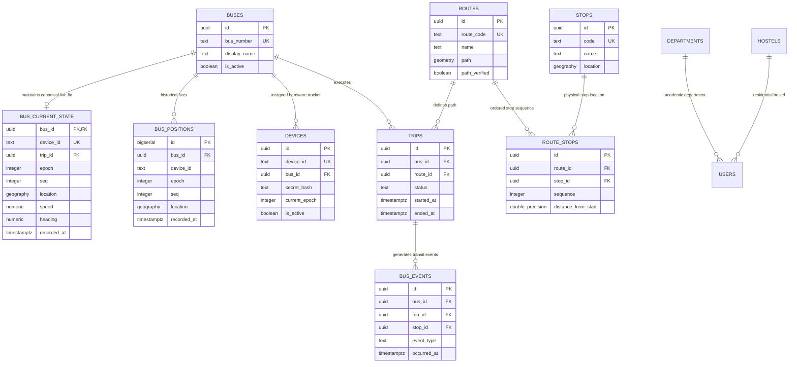

# Database Schema & Data Dictionary

## 1. Overview & Database Architecture

The authoritative database engine is **PostgreSQL 17.11.0.003** hosted on Supabase (`fnngudikrvelpuhngtlw`, AWS `ap-northeast-1`). The spatial foundation is provided by **PostGIS 3.4** (`geometry`, `geography`, spatial indexing, and distance operators).

### Extensions Installed
- `postgis` (v3.4.2): Geospatial types, spatial predicates (`ST_DWithin`, `ST_LineLocatePoint`, `ST_Distance`).
- `pgcrypto`: Cryptographic hashing (`crypt()`, `gen_salt('bf', 8)`).
- `uuid-ossp` / `pg_trgm`: UUID generation and trigram search.

---

## 2. Entity-Relationship Model

---

## 3. Comprehensive Table Inventory

### 3.1 `buses`
Primary vehicle registry. Represents physical campus transit shuttles.
- **Columns:**
  - `id` (`uuid`, PK, default `gen_random_uuid()`): Unique identifier.
  - `bus_number` (`text`, NOT NULL, UNIQUE): Registration number (e.g. `'KL-11-AV-1234'`).
  - `display_name` (`text`, NOT NULL): Rider-facing name (e.g. `'Campus Shuttle A'`).
  - `is_active` (`boolean`, NOT NULL, default `true`): Administrative enablement flag.
  - `created_at` / `updated_at` (`timestamptz`, default `now()`).
- **Access & RLS:** RLS enabled. Direct `SELECT` revoked from `anon` and `authenticated`. Read via `get_active_bus_positions_v2()`.

### 3.2 `devices`
Hardware tracker registry and authentication store.
- **Columns:**
  - `id` (`uuid`, PK, default `gen_random_uuid()`): Internal identifier.
  - `device_id` (`text`, NOT NULL, UNIQUE): Hardware text identifier (e.g. `'NITC-BUS-001'`).
  - `bus_id` (`uuid`, NOT NULL, FK $\to$ `buses.id`): Assigned vehicle.
  - `secret_hash` (`text`, NOT NULL): 8-round Bcrypt hash of device secret (`$2a$08$...`).
  - `current_epoch` (`integer`, NOT NULL, default `1`): Current active session epoch.
  - `last_session_id` (`text`, NULL): Nonce of last successful session reset for idempotent retry.
  - `is_active` (`boolean`, NOT NULL, default `true`): Kill-switch flag.
  - `last_seen_at` (`timestamptz`, NULL): Timestamp of latest packet ingestion.
- **Access & RLS:** RLS enabled. Strictly isolated to `service_role`. No public access.

### 3.3 `routes`
Transit route definitions and spatial polyline paths.
- **Columns:**
  - `id` (`uuid`, PK, default `gen_random_uuid()`).
  - `route_code` (`text`, NOT NULL, UNIQUE): Identifier (e.g. `'MAIN_CIRCULAR'`).
  - `name` (`text`, NOT NULL): Name (e.g. `'Main Gate - East Campus Circular'`).
  - `description` (`text`, NULL).
  - `direction` (`text`, NOT NULL, default `'loop'`): `'loop'`, `'forward'`, `'reverse'`.
  - `path` (`geometry(LineString, 4326)`, NULL): Spatial polyline representing the road route.
  - `path_source` (`text`, default `'manual'`): `'osm'`, `'manual'`, `'gps_trace'`.
  - `path_verified` (`boolean`, default `false`): Verification flag.
  - `is_active` (`boolean`, default `true`).
- **Indexes:** Spatial GIST index on `path`.
- **Access & RLS:** RLS enabled. Public read granted to `anon` and `authenticated`.

### 3.4 `stops`
Physical campus bus stops.
- **Columns:**
  - `id` (`uuid`, PK, default `gen_random_uuid()`).
  - `code` (`text`, NOT NULL, UNIQUE): Short code (e.g. `'MAIN_GATE'`).
  - `name` (`text`, NOT NULL): Display name (e.g. `'Main Gate Shuttle Stop'`).
  - `location` (`geography(Point, 4326)`, NOT NULL): PostGIS spherical coordinate point.
  - `latitude` / `longitude` (`double precision`, NOT NULL): Normalized decimal degrees.
  - `is_active` (`boolean`, default `true`).
- **Indexes:** Spatial GIST index on `location`.
- **Access & RLS:** RLS enabled. Public read granted to `anon` and `authenticated`.

### 3.5 `route_stops`
Ordered sequence of stops defining each route.
- **Columns:**
  - `id` (`uuid`, PK, default `gen_random_uuid()`).
  - `route_id` (`uuid`, NOT NULL, FK $\to$ `routes.id` ON DELETE CASCADE).
  - `stop_id` (`uuid`, NOT NULL, FK $\to$ `stops.id` ON DELETE RESTRICT).
  - `sequence` (`integer`, NOT NULL): 1-indexed order along the route.
  - `distance_from_start` (`double precision`, default `0.0`): Distance in meters along the polyline.
  - `estimated_duration_sec` (`integer`, default `0`): Baseline travel time from start.
- **Constraints:** UNIQUE `(route_id, sequence)`.
- **Access & RLS:** Public read granted to `anon` and `authenticated`.

### 3.6 `trips`
Operational runs of a bus on a specific route.
- **Columns:**
  - `id` (`uuid`, PK, default `gen_random_uuid()`).
  - `bus_id` (`uuid`, NOT NULL, FK $\to$ `buses.id`).
  - `route_id` (`uuid`, NOT NULL, FK $\to$ `routes.id`).
  - `status` (`text`, NOT NULL, CHECK in `'scheduled', 'active', 'completed', 'cancelled'`).
  - `started_at` (`timestamptz`, NULL).
  - `ended_at` (`timestamptz`, NULL).
- **Indexes:**
  - Partial Unique Index: `(bus_id) WHERE status = 'active'` (ensures at most one active trip per bus).
  - *Audit Note:* The live database contains two duplicate identical indexes: `trips_one_active_per_bus` and `trips_single_active_per_bus`.
- **Access & RLS:** RLS enabled.

### 3.7 `bus_current_state`
High-speed, single-row-per-bus canonical live state table.
- **Columns:**
  - `bus_id` (`uuid`, PK, FK $\to$ `buses.id` ON DELETE CASCADE).
  - `device_id` (`text`, NOT NULL, UNIQUE).
  - `trip_id` (`uuid`, NULL, FK $\to$ `trips.id`).
  - `epoch` (`integer`, NOT NULL, default `1`): Current session epoch.
  - `seq` (`integer`, NOT NULL, default `0`): Latest accepted sequence counter.
  - `location` (`geography(Point, 4326)`, NOT NULL): Latest coordinate.
  - `latitude` / `longitude` (`double precision`, NOT NULL).
  - `speed` (`numeric`, default `0.0`): km/h.
  - `heading` (`numeric`, default `0.0`): Degrees.
  - `accuracy` (`numeric`, default `0.0`): Meters.
  - `status` (`text`, default `'stationary'`).
  - `recorded_at` (`timestamptz`, NOT NULL): GPS fix timestamp.
  - `updated_at` (`timestamptz`, default `now()`).
- **Indexes:** Spatial GIST on `location`.
- **Access & RLS:** RLS enabled. `SELECT` revoked from `anon`/`authenticated` in migration `20261014050000`. Read via `get_active_bus_positions_v2()`.

### 3.8 `bus_positions`
Append-only historical trajectory table.
- **Columns:**
  - `id` (`bigserial`, PK).
  - `bus_id` (`uuid`, NOT NULL, FK $\to$ `buses.id`).
  - `device_id` (`text`, NOT NULL).
  - `trip_id` (`uuid`, NULL, FK $\to$ `trips.id`).
  - `epoch` (`integer`, NOT NULL).
  - `seq` (`integer`, NOT NULL).
  - `location` (`geography(Point, 4326)`, NOT NULL).
  - `latitude` / `longitude` (`double precision`, NOT NULL).
  - `speed` / `heading` / `accuracy` (`numeric`).
  - `recorded_at` (`timestamptz`, NOT NULL).
  - `created_at` (`timestamptz`, default `now()`).
- **Constraints:** UNIQUE `uq_bus_positions_device_epoch_seq (device_id, epoch, seq)`.
- **Indexes:**
  - Spatial GIST on `location`.
  - BRIN index on `recorded_at` (optimized for time-series range queries).
  - B-tree on `(trip_id, recorded_at)`.
  - B-tree on `(bus_id, seq DESC)`.

### 3.9 `bus_events`
Transactional transit event journal.
- **Columns:**
  - `id` (`uuid`, PK, default `gen_random_uuid()`).
  - `bus_id` (`uuid`, NOT NULL, FK $\to$ `buses.id`).
  - `trip_id` (`uuid`, NULL, FK $\to$ `trips.id`).
  - `stop_id` (`uuid`, NULL, FK $\to$ `stops.id`).
  - `event_type` (`text`, NOT NULL, CHECK in `'trip_started', 'trip_ended', 'stop_arrival', 'stop_departure', 'route_deviation', 'status_changed'`).
  - `occurred_at` (`timestamptz`, NOT NULL).
  - `metadata` (`jsonb`, default `'{}'::jsonb`).
- **Access & RLS:** Read via `get_active_trip_stop_events(p_trip_id)`.

### 3.10 Auxiliary Tables
- `bus_timings`: Static timetable departures (`route_id`, `departure_time`, `day_of_week`). Public read.
- `campus_buildings`: NITC buildings and POIs with spatial polygons for map rendering. Public read.
- `departments` / `hostels`: Academic and residential reference lists for user profile onboarding. Public read.
- `users`: Student profile records linking to Supabase Auth (`user_id` $\to$ `auth.users.id`).
