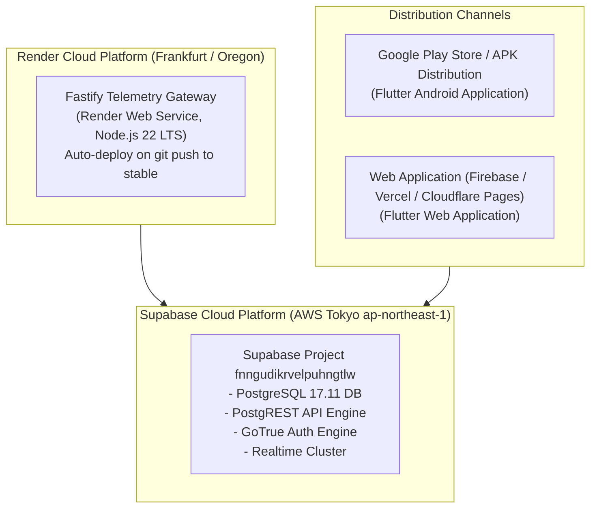

# Deployment, Hosting, & Configuration

## 1. Production Topology & Hosting Environment

The Tracklet production ecosystem consists of three managed environments:



---

## 2. Environment Variables & Secret Configuration

### 2.1 Fastify Backend (`backend_bus_tracker`)

Configured in Render Dashboard under **Environment**:

| Variable Name | Required | Default | Purpose / Description |
|---|---|---|---|
| `PORT` | No | `3000` | Port on which Fastify listens. |
| `HOST` | No | `0.0.0.0` | Network binding interface. |
| `NODE_ENV` | Yes | `production` | Node environment (`production`, `development`, `test`). |
| `SUPABASE_URL` | Yes | *(None)* | Supabase project API URL (`https://fnngudikrvelpuhngtlw.supabase.co`). |
| `SUPABASE_SERVICE_ROLE_KEY` | Yes | *(None)* | High-privilege secret key granting database bypass for telemetry ingestion. |
| `JWT_SECRET` | Yes | *(None)* | Cryptographic HMAC key used to sign and verify device Bearer JWTs. |
| `JWT_EXPIRES_IN` | No | `24h` | Validity duration for device session tokens. |
| `CORS_ORIGIN` | No | `*` | Allowed CORS origins for administrative dashboards. |
| `REDIS_URL` | No | *(None)* | Optional Redis connection string for distributed rate limiting. |
| `METRICS_TOKEN` | No | *(None)* | Bearer token protecting the `/metrics` endpoint. |

> [!CAUTION]
> **Secret Boundary Invariant:**
> The `SUPABASE_SERVICE_ROLE_KEY` must **never** be shared with mobile clients, committed to git, or exposed in client bundles. It must reside exclusively in Render environment variables.

---

### 2.2 Flutter Mobile Client (`NITC_BUS_TRACKING_APP`)

Configured at compile time via `--dart-define` or `--dart-define-from-file`:

| Key Name | Required | Example Value | Description |
|---|---|---|---|
| `SUPABASE_URL` | Yes | `https://fnngudikrvelpuhngtlw.supabase.co` | Public Supabase HTTPS endpoint. |
| `SUPABASE_ANON_KEY` | Yes | `eyJhbGciOi...` | Public anonymous client API key. |
| `ONESIGNAL_APP_ID` | No | `550e8400-e29b-41d4-...` | OneSignal push notification application ID. |
| `MAP_STYLE_URL` | No | `https://tiles.openfreemap.org/styles/liberty` | Vector map tile style JSON URL. |

---

## 3. Build & Operational Runbook

### 3.1 Fastify Backend Operations
- **Install Dependencies:**
  ```bash
  cd /Users/shashankmergu/Desktop/backend_bus_tracker
  npm ci
  ```
- **Execute Unit & Integration Tests:**
  ```bash
  npm test
  ```
- **Build TypeScript to JavaScript:**
  ```bash
  npm run build
  ```
- **Local Development Server:**
  ```bash
  npm run dev
  ```
- **Production Server Start:**
  ```bash
  node dist/server.js
  ```

### 3.2 Flutter Mobile Operations
- **Fetch Dependencies:**
  ```bash
  cd /Users/shashankmergu/Desktop/NITC_BUS_TRACKING_APP
  flutter pub get
  ```
- **Run Architectural Boundary Verification:**
  ```bash
  dart run tool/verify_architecture.dart
  ```
- **Run Unit & Transit Logic Tests:**
  ```bash
  flutter test
  ```
- **Build Production Android APK:**
  ```bash
  flutter build apk --release --dart-define-from-file=config/prod.json
  ```
- **Build Flutter Web Bundle:**
  ```bash
  flutter build web --release --dart-define-from-file=config/prod.json
  ```

---

## 4. Database Migration Management

All canonical database migrations are stored under:
`NITC_BUS_TRACKING_APP/supabase/migrations/`

### Migration Protocol
1. New migrations must use UTC timestamp prefixes: `YYYYMMDDHHMMSS_description.sql`.
2. Migrations must be strictly additive and backward-compatible with deployed Fastify and Flutter code.
3. Apply migration to local development environment:
   ```bash
   supabase db reset
   ```
4. Verify migration against live staging/production database catalog before committing.
