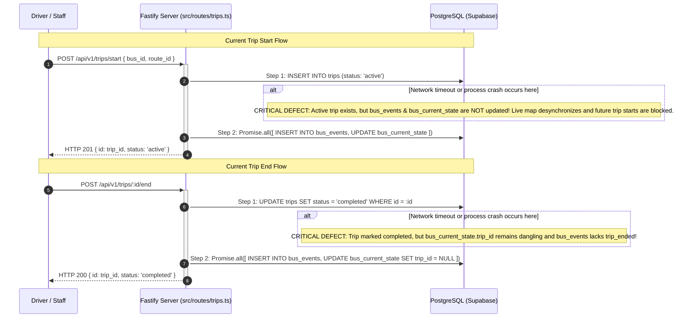
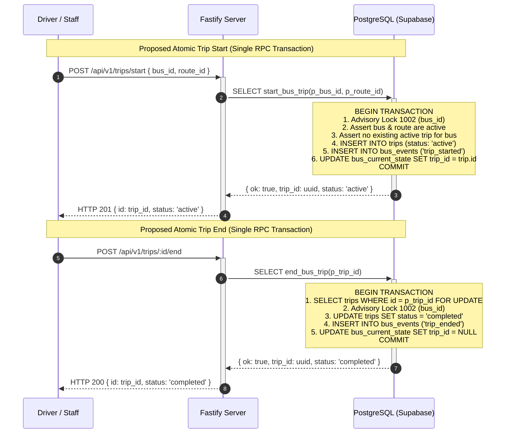

# Trip Lifecycle Sequence Diagram

> [!IMPORTANT]
> **Implementation Status Note:**  
> The diagrams below contrast the **current production defect** (multiple sequential HTTP requests in Fastify `src/routes/trips.ts`) against the **proposed atomic RPC target** (`start_bus_trip` and `end_bus_trip`). The atomic RPCs are recommendations under review and have **not yet been applied to production**.

---

## 1. Current Production Implementation (Vulnerable to Partial Failures)

---

## 2. Proposed Target Architecture (Atomic Database Transactions)

