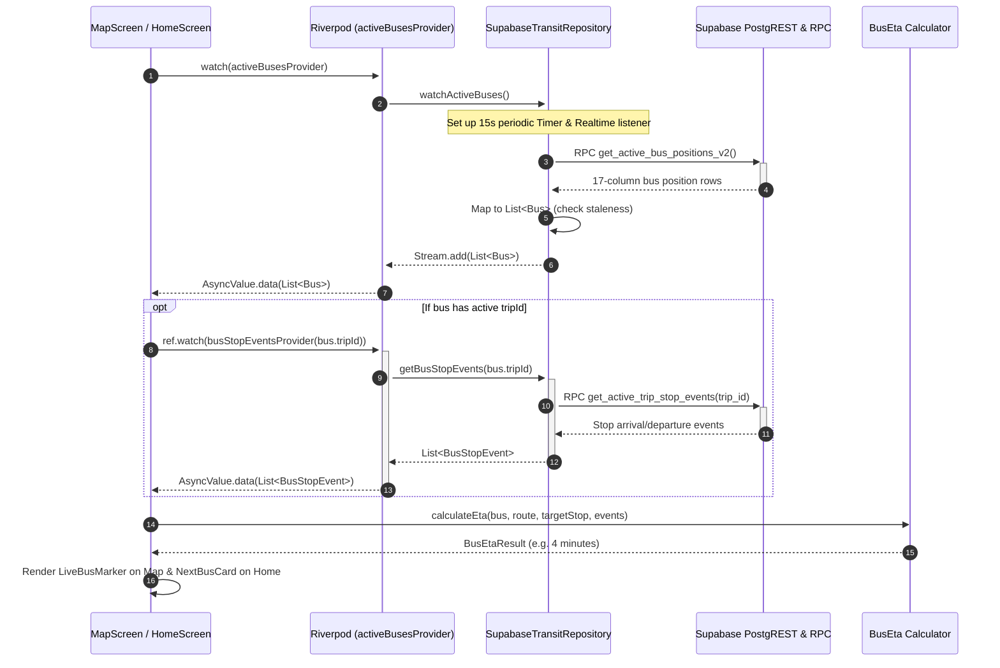

# Flutter Application Architecture

## 1. Architectural Principles & Directory Structure

Tracklet's mobile client (`NITC_BUS_TRACKING_APP`, branch `main`) is written in Dart and Flutter, targeting Android and Web. The codebase enforces strict, automated architectural boundaries validated via `dart run tool/verify_architecture.dart`.

```
lib/
├── app/                        # Application bootstrap, routing, app lifecycle
│   ├── app.dart                # MaterialApp.router configuration, theme injection
│   └── router.dart             # GoRouter declarative navigation routes
├── core/                       # Zero-dependency utilities, geo primitives, logging
│   ├── config/app_config.dart  # Compile-time environment configuration (--dart-define)
│   ├── geo/geo_point.dart      # Immutable geographic coordinate model & Haversine math
│   └── logging/app_logger.dart # Structured console & diagnostic logger
├── design_system/              # Reusable design tokens and UI components (Moon DS v1 inspired)
│   ├── tokens/                 # Colors, typography, spacing, radii, shadows
│   ├── theme/tracklet_theme.dart# Light & Dark ThemeData builders
│   └── components/             # TrackletButton, TrackletCard, TrackletStatusBadge, etc.
├── data/                       # Data layer: Models, Repositories, Supabase integration
│   ├── auth/                   # AuthRepository, AuthState, NITC email validator
│   ├── profile/                # Profile model and repository
│   ├── campus/                 # CampusBuilding, Hostel models and repositories
│   ├── academic/               # Department model and repository
│   ├── preferences/            # UserPreferences (favorite stops, routes, notification toggles)
│   ├── supabase/               # SupabaseClientProvider singleton
│   └── transit/                # Bus, Stop, BusRoute, BusPosition, BusEta, TransitRepository
├── services/                   # Device platform services
│   ├── location/               # Geolocator platform wrapper for user GPS
│   ├── maps/                   # MapAdapter, offline tile cache manager (IO vs Web)
│   ├── notifications/          # OneSignal / Local push notification service
│   └── storage/                # SharedPreferences / SecureStorage key-value wrapper
└── features/                   # User-facing modules & presentation widgets
    ├── auth/                   # Login, account creation, password reset screens
    ├── onboarding/             # Academic & residential profile setup flow
    ├── home/                   # Transit dashboard, upcoming buses, route progress cards
    ├── map/                    # Interactive campus map, bus markers, stop detail sheets
    ├── profile/                # User profile screen
    └── settings/               # App preferences, legal notices, notification settings
```

---

## 2. Automated Layer Boundary Rules

The project script `tool/verify_architecture.dart` checks imports before every commit:
- `core/` cannot depend on `features/`, `data/`, or `services/`.
- `design_system/` cannot depend on application layers.
- Features cannot import other features (features are modular and isolated).
- Features cannot import vendor SDKs directly (e.g. no direct `supabase_flutter` calls in UI widgets; all calls must flow through `data/` repositories or `services/`).
- `dart:io` is strictly prohibited in application code to preserve Flutter Web compatibility (platform-specific code is isolated in `.dart` vs `_io.dart` / `_web.dart` adapters).

---

## 3. State Management (Riverpod)

The application standardizes on **Flutter Riverpod** (`flutter_riverpod: ^2.6.1`).

### Primary Providers
1. **`transitRepositoryProvider` (`Provider<TransitRepository>`):**
   - Instantiates `SupabaseTransitRepository(ref.watch(supabaseClientProvider))`.
2. **`activeBusesProvider` (`StreamProvider<List<Bus>>`):**
   - Calls `transitRepository.watchActiveBuses()`, emitting new bus lists on Realtime events or the 15-second timer fallback.
3. **`busStopEventsProvider` (`FutureProvider.family<List<BusStopEvent>, String>`):**
   - Fetches cached stop events for an active `trip_id` via `transitRepository.getBusStopEvents(tripId)`.
4. **`mapStateProvider` (`StateNotifierProvider<MapStateNotifier, MapState>`):**
   - Manages interactive map camera, selected route filter, selected bus marker, and stop bottom sheets.
5. **`homeProvider` (`StateNotifierProvider<HomeNotifier, HomeState>`):**
   - Aggregates user location, nearest campus stop, upcoming departures, and active bus arrival estimates.

---

## 4. Live Tracking Call Chain

When a user opens the app or views the campus map, the data flow proceeds as follows:


