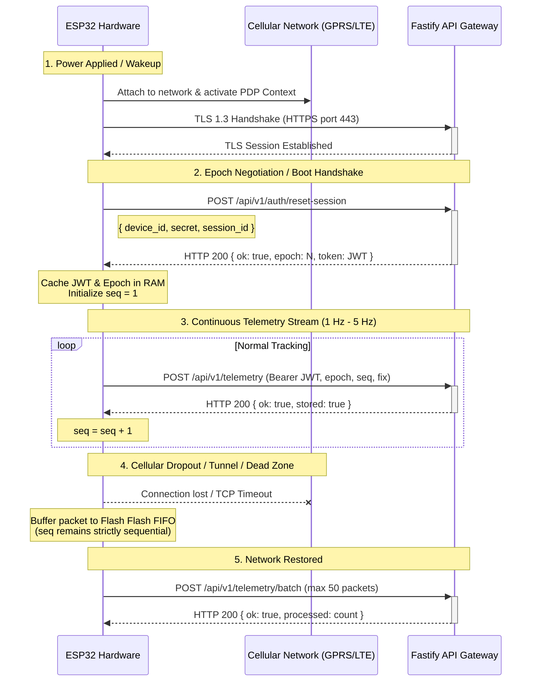

# Hardware & Device Architecture

## 1. Overview and Operational Role

The Tracklet hardware tier consists of dedicated tracking units installed permanently or semi-permanently on physical NITC campus shuttle buses. The tracker is responsible for acquiring high-precision geographic coordinates, calculating instantaneous velocity and heading, packaging data into encrypted telemetry payloads, buffering records during cellular dropouts, and transmitting telemetry to the Fastify API Gateway.

---

## 2. Hardware Component Inventory

| Component | Model / Specification | Interface / Protocol | Configuration Source | Verification Status |
|---|---|---|---|---|
| **Microcontroller (MCU)** | ESP32-WROOM-32 (Dual-Core Xtensa @ 240 MHz, 520 KB SRAM, 4 MB Flash) | SPI / UART / I2C | Inferred from codebase docs & simulator scripts | **Inferred** |
| **GNSS Receiver** | u-blox NEO-6M / NEO-8M or Quectel L76K (NMEA 0183 output) | Hardware UART (e.g., UART2, 9600 / 115200 baud) | NMEA sentences (`$GPRMC`, `$GPGGA`) | **Inferred** |
| **Cellular Modem** | SIMCom SIM800L (2G GPRS) or SIM7600E (4G LTE Cat-1) | AT commands over UART | APN configuration in firmware | **Inferred** |
| **Non-Volatile Storage** | ESP32 Internal Flash (SPIFFS / LittleFS / NVS partition) | SPI Flash Controller | Circular FIFO queue for offline batch storage | **Confirmed by API Batch Contract** |
| **Power Supply** | 12V / 24V Vehicle Bus Step-down to 5V 2A DC-DC Buck Converter + LiPo backup | Direct vehicle battery terminal or accessory line | Operational assumption for campus bus trackers | **Unknown / Unverified** |
| **Antennas** | External active GPS antenna (SMA) + External GSM/LTE whip antenna | Coaxial SMA / IPEX | Physical installation requirement | **Unknown / Unverified** |

> [!IMPORTANT]
> **Source-of-Truth Note on Hardware:**
> Physical hardware schematics, PCB Gerber files, and ESP32 C++ firmware repositories are maintained externally from the primary application repositories. The software contracts in Fastify (`TelemetryBody`, `DeviceAuthBody`, `ResetSessionBody`) define the strict behavioral requirements that any compliant tracker hardware must meet.

---

## 3. GNSS & Positioning Specifications

Hardware trackers must adhere to the following coordinate and measurement conventions:

1. **Coordinate Reference System (CRS):**
   - Standard WGS 84 (`EPSG:4326`).
   - Latitude: Decimal degrees in range `[-90.0, 90.0]`. Fastify enforces the NITC campus corridor: `11.200000 <= latitude <= 11.450000`.
   - Longitude: Decimal degrees in range `[-180.0, 180.0]`. Fastify enforces the NITC campus corridor: `75.800000 <= longitude <= 76.100000`.
2. **Velocity / Speed:**
   - Unit: **Kilometers per hour (km/h)** as a floating-point number.
   - Range: `0.0 <= speed <= 120.0 km/h`.
   - *Note:* While PostGIS stores speed as numeric and the database validates bounds $\le 120\text{ km/h}$, the Flutter ETA engine internally converts this to meters per second via `speedMetersPerSecond = speedKmH / 3.6`.
3. **Heading / Course:**
   - Unit: **Degrees clockwise from True North**.
   - Range: `0.0 <= heading < 360.0`.
   - *Normalization:* Fastify automatically normalizes `heading = 360.0` to `0.0`. Negative headings or values $> 360.0$ are rejected with HTTP 422.
4. **Accuracy:**
   - Unit: **Horizontal Dilution of Precision (HDOP) or estimated horizontal error in meters**.
   - Maximum allowed threshold: $50.0\text{ meters}$. Telemetry with accuracy $> 50\text{ m}$ is rejected by Fastify as degraded fix.

---

## 4. Communication & Transport Layer

### 4.1 Protocol Transport Details
- **Protocol:** HTTPS / TLS 1.2 or TLS 1.3 over standard TCP port 443.
- **Payload Format:** UTF-8 encoded JSON (`Content-Type: application/json`).
- **Connection Reuse:** HTTP/1.1 Keep-Alive is recommended to minimize cellular TCP/TLS handshake latency and data consumption.
- **Request Timeout:** Firmware HTTP client timeout should be set to **5,000 ms**.
- **Retry Backoff:** Exponential backoff with jitter on network failure (`1s, 2s, 4s, 8s, max 30s`).

---

## 5. Device Identification & Security Invariants

1. **Hardware Device ID (`device_id`):**
   - Text string, 3 to 64 alphanumeric characters (plus hyphens/underscores).
   - Format convention: `NITC-BUS-001`, `NITC-BUS-002`, `SIMULATOR-001`.
   - Primary identifier stored in `devices.device_id` and included in JWT `sub` claim.
2. **Device Secret:**
   - High-entropy pre-shared key (PSK) provisioned into hardware flash during manufacturing/installation.
   - **Length invariant:** Must be between **16 and 128 characters** (verified in Fastify schema).
   - Secret is **never stored in plaintext** in the database; it is stored as an 8-salt-round Bcrypt hash (`$2a$08$...`).
3. **JWT Session Token:**
   - Issued by Fastify on `/api/v1/auth/device` or `/api/v1/auth/reset-session`.
   - Algorithm: `HS256`.
   - Expiration: Configurable via `JWT_EXPIRES_IN` (typically 24 hours).
   - Firmware must automatically refresh the JWT if it receives an HTTP 401 response.

---

## 6. Offline Buffering & Power Management

### 6.1 Offline Buffer Policy
- When the cellular connection drops, the MCU must write telemetry packets into a local non-volatile FIFO buffer (e.g., SPIFFS or LittleFS circular file).
- The FIFO buffer must preserve the exact chronological sequence: `(device_id, epoch, seq)`.
- When connectivity resumes:
  - If backlog $\le 50$ packets: Firmware flushes the batch via `POST /api/v1/telemetry/batch`.
  - If backlog $> 50$ packets: Firmware flushes in sequential chunks of 50 packets ordered by `seq ASC`.
- **Buffer Cap:** Firmware should cap the offline queue (e.g., 2,000 packets $\approx 30$ minutes of tracking at 1 Hz) to prevent storage exhaustion. If the buffer overflows, oldest unsent packets are dropped first.

### 6.2 Power Supply & Reboot Behavior
- **Vehicle Ignition Link:** Trackers are connected to vehicle auxiliary power. When the bus engine starts, the ESP32 experiences a cold boot.
- **Reboot Handshake:** On every boot, the MCU **must generate a new unique `session_id`** (e.g., UUIDv4 or random 16-byte hex string) and execute `POST /api/v1/auth/reset-session`.
- **Idempotency on Reboot:** If the tracker reboots, calls `/api/v1/auth/reset-session`, but drops cellular connection before receiving the response, it retries with the **same `session_id`**. PostgreSQL recognizes the duplicate `session_id` and idempotently returns the established `epoch` without incrementing again.
