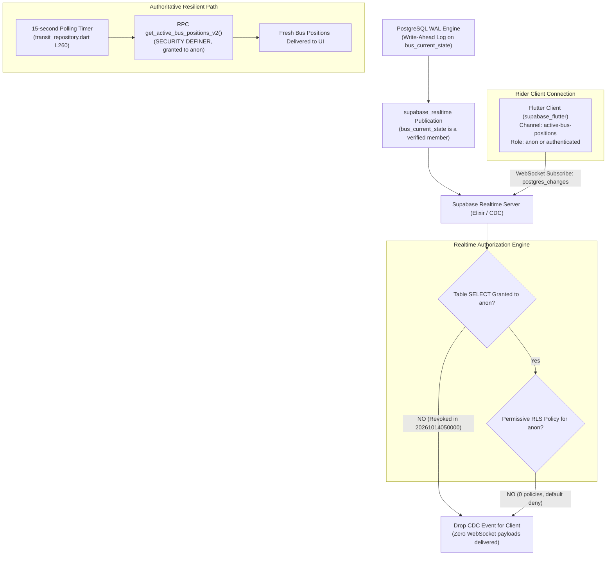
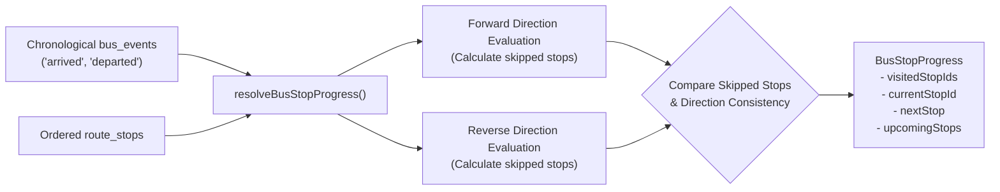

# Realtime, Maps, & Freshness Policy

## 1. Realtime Synchronization Architecture

The mobile client requires timely location updates to render live buses accurately on the campus map. The synchronization strategy combines **Supabase Realtime WebSockets** and an **automatic periodic polling fallback**.

### 1.1 Verified Supabase Realtime CDC Configuration & RLS Interaction

A deep inspection of the live PostgreSQL database catalog (`fnngudikrvelpuhngtlw`) reveals the exact interaction between Supabase Realtime, PostgreSQL permissions, and Row-Level Security:



#### Exact Verified Database Evidence
1. **Publication Membership:**
   - Querying `pg_publication_tables` confirms `bus_current_state` **is** an active member of `pubname = 'supabase_realtime'`.
2. **Table-Level Privileges:**
   - Querying `information_schema.table_privileges` confirms that `anon` and `authenticated` roles hold **only `REFERENCES` and `TRIGGER`** privileges. `SELECT`, `INSERT`, `UPDATE`, and `DELETE` are revoked.
   - Only `service_role` and `postgres` possess `SELECT` privilege on `bus_current_state`.
3. **Row-Level Security (RLS) State:**
   - `pg_tables.rowsecurity` is `true`.
   - `pg_policies` contains **zero** policies for `bus_current_state`. Under PostgreSQL's default-deny RLS model, non-superusers cannot read rows.
4. **Realtime Server Evaluation:**
   - When the client connects over WebSocket presenting an `anon` key and subscribes to `postgres_changes` on `bus_current_state`, the Supabase Realtime CDC engine evaluates whether the subscriber's role has permission to read the changed row under RLS.
   - Because `SELECT` is absent and no permissive RLS policy exists, the Realtime engine intentionally suppresses CDC event payloads to prevent leaking raw, unprojected internal state.

#### Client-Side Design & Polling Invariant
In [`transit_repository.dart`](file:///Users/shashankmergu/Desktop/NITC_BUS_TRACKING_APP/lib/data/transit/transit_repository.dart#L247-L265), the client implementation acknowledges this exact constraint:
```dart
channel = client
    .channel('active-bus-positions')
    .onPostgresChanges(
      event: PostgresChangeEvent.all,
      schema: 'public',
      table: 'bus_current_state',
      callback: (_) => unawaited(refresh()),
    )
    .subscribe();

// Narrow rider RPCs do not grant table SELECT, so retain bounded refresh
// even when Realtime row authorization correctly rejects raw state.
pollTimer = Timer.periodic(const Duration(seconds: 15), (_) {
  unawaited(refresh());
});
```
- **Architectural Policy:** Tracklet **retains 15-second polling via `get_active_bus_positions_v2()` as the primary, resilient production baseline**.
- Any future transition to sub-second push delivery must not bypass security by granting raw table `SELECT`. Instead, a dedicated Realtime Broadcast trigger or restricted projection channel must be formally verified.

---

## 2. Route Geometry & Map Matching

### 2.1 Spatial LineStrings
Transit routes are defined as PostGIS geometries (`geometry(LineString, 4326)` in `routes.path`). Coordinates trace the actual roadway corridors of the NITC campus (Main Gate, Rajpath, Mega Hostel bypass, East Campus).

### 2.2 Client-Side Route Projection (`RouteProgressProjector`)
Rather than relying on database PostGIS calls for live trajectory projection, Flutter computes route progress locally on the device using `RouteProgressProjector` ([`lib/data/transit/bus_eta.dart`](file:///Users/shashankmergu/Desktop/NITC_BUS_TRACKING_APP/lib/data/transit/bus_eta.dart#L71-L150)):
- **Tangent Plane Projection:** Projects the bus coordinate onto each segment of the route polyline using a local flat-earth approximation.
- **Segment Matching:** Identifies the closest segment index and calculates the distance along the route (`alongMeters`) and the perpendicular offset from the road center (`offsetMeters`).
- **Off-Route Threshold:** If `offsetMeters > 150.0 meters`, the bus is flagged as `offRoute` and the ETA engine returns `BusEtaStatus.offRoute`.

---

## 3. Direction-Aware Stop Progress Engine

NITC transit routes include circular loops (e.g. `Main Gate -> Hostels -> Academic Zone -> Main Gate`) and bidirectional out-and-back routes. A bus near a stop does not prove whether it is outbound or inbound.

Tracklet resolves direction in [`lib/data/transit/bus_stop_progress.dart`](file:///Users/shashankmergu/Desktop/NITC_BUS_TRACKING_APP/lib/data/transit/bus_stop_progress.dart#L26-L68) using **historical stop event sequences**:



1. **Cycle Matching:** For circular loop routes where `first.stopId == last.stopId`, the engine treats the stop list as a modulo ring.
2. **Disambiguation:** If forward and reverse evaluations tie on skipped stops, the engine checks the route's configured nominal `direction` (`'loop'`, `'forward'`, `'reverse'`).
3. **No Fabrication:** If event evidence is ambiguous or contradictory, `resolveBusStopProgress()` returns `null` rather than fabricating an incorrect next stop.

---

## 4. Client-Side ETA Calculation Policy

Tracklet calculates arrival estimates using physics and kinematics in [`lib/data/transit/bus_eta.dart`](file:///Users/shashankmergu/Desktop/NITC_BUS_TRACKING_APP/lib/data/transit/bus_eta.dart#L225-L330):

$$\text{ETA (seconds)} = \frac{\text{Remaining Distance along Route (meters)}}{\text{Smoothed Velocity (m/s)}} + \sum (\text{Dwell time per intermediate stop})$$

### Invariant: Honest "Unavailable" State
The app **never invents an ETA** when physical telemetry is insufficient. An explicit `BusEtaResult.unavailable(reason)` is returned under any of the following conditions:

| Invalidation Condition | Result Status | UI Presentation |
|---|---|---|
| Telemetry fix $> 60\text{ seconds}$ old | `staleTelemetry` | Badge: Amber "Stale", ETA: "Unavailable" |
| Bus offset from route $> 150\text{ meters}$ | `offRoute` | Badge: "Off Route", ETA: "Unavailable" |
| Stop event history contradicts route | `unresolvedStopProgress` | ETA: "Unavailable" |
| Bus dwelling inside stop radius ($< 30\text{ m}$) | `dwellingAtStop` | Badge: "At Stop", ETA: "Boarding" |
| Bus stationary ($< 2\text{ km/h}$) away from stop | `stationary` | Badge: "Delayed / Paused", ETA: "Unavailable" |
| Route geometry has $< 2$ points | `invalidGeometry` | ETA: "Unavailable" |
| GPS speed implausible ($> 120\text{ km/h}$) | `invalidSpeed` | ETA: "Unavailable" |
