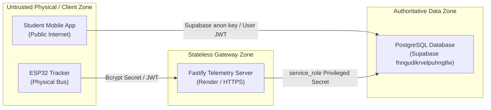

# Security & Threat Modeling

## 1. Threat Model & Trust Boundaries

Tracklet's security posture is designed around the reality that hardware trackers operate in an insecure physical environment, the mobile client runs on untrusted student devices, and the backend gateway bridges between untrusted inputs and the authoritative database.



---

## 2. Authentication & Credential Architecture

### 2.1 Hardware Device Authentication
1. **Zero Plaintext Storage:** Device secrets are **never** stored in plaintext. They are hashed using **Bcrypt with 8 salt rounds** (`bcryptjs` in Node.js, `pgcrypto.crypt()` in PostgreSQL).
2. **Algorithm Normalization:** Fastify and PostgreSQL normalize Bcrypt hash prefixes (`$2b$` $\to$ `$2a$`) to ensure 100% interoperability between Node.js and PostgreSQL's OpenBSD-derived Bcrypt implementation.
3. **Secret Length Invariant:** Device secrets must be between **16 and 128 characters**.
   - *Audit Finding:* Fastify enforces `minLength: 16`, but `register_tracking_device` in SQL checked `length < 8`. A patch is required to enforce $\ge 16$ across all database functions.
4. **JWT Verification:**
   - Tokens issued to devices use `HS256` signed by `JWT_SECRET`.
   - The token payload embeds `sub: device_id` and `epoch: N`.
   - Fastify's `onRequest` hook validates the JWT and asserts that `body.device_id === request.user.sub`, preventing any device from spoofing another device's coordinates.

### 2.2 Rider & Mobile Client Authentication
1. **Public Rider Access:** Read access to static routes, stops, and active bus markers (`get_active_bus_positions_v2`) is granted to anonymous riders (`anon` key). No login is required to see campus transit.
2. **Student Profile Authentication:** Supabase Auth manages student accounts. Student signups are validated to restrict registration to legitimate NITC institutional emails (`@nitc.ac.in`) via `is_nitc_email()` database trigger.

---

## 3. Database Role Permissions & RLS Matrix

| Table / Database Object | Role: `anon` | Role: `authenticated` | Role: `service_role` | Effective Access Mechanism |
|---|---|---|---|---|
| `buses` | **REVOKED** | **REVOKED** | ALL | Projected via `get_active_bus_positions_v2` RPC |
| `devices` | **REVOKED** | **REVOKED** | ALL | Isolated to Fastify server and provisioning scripts |
| `routes` | SELECT | SELECT | ALL | Public RLS read policy |
| `stops` | SELECT | SELECT | ALL | Public RLS read policy |
| `route_stops` | SELECT | SELECT | ALL | Public RLS read policy |
| `bus_positions` | **REVOKED** | **REVOKED** | ALL | Isolated to `ingest_telemetry_packet` RPC |
| `bus_current_state` | **REVOKED** | **REVOKED** | ALL | Projected via `get_active_bus_positions_v2` RPC |
| `bus_events` | **REVOKED** | **REVOKED** | ALL | Projected via `get_active_trip_stop_events` RPC |
| `campus_buildings` | SELECT | SELECT | ALL | Public RLS read policy |
| `bus_timings` | SELECT | SELECT | ALL | Public RLS read policy |
| `users` | **REVOKED** | SELECT/UPDATE (Own ID) | ALL | Row-Level Security: `auth.uid() = user_id` |

---

## 4. `SECURITY DEFINER` Function Hardening

Every `SECURITY DEFINER` function runs with database owner privileges (`postgres`). To prevent privilege escalation attacks:

1. **Search-Path Pinning:** Every function explicitly sets:
   ```sql
   SET search_path = public, pg_temp;
   -- or for SQL functions:
   SET search_path = pg_catalog, public, pg_temp;
   ```
   This prevents attacks where a malicious user creates a custom function or table in a temporary schema or public schema to hijack system operator resolution.
2. **Explicit Role Grants:**
   - Functions modifying internal state (`ingest_telemetry_packet`, `reset_device_sequence`, `register_tracking_device`, `set_device_active`) have execution revoked from `PUBLIC` and granted **strictly to `service_role`**.
   - Read projection functions (`get_active_bus_positions_v2`, `get_active_trip_stop_events`) are granted to `anon` and `authenticated`.

---

## 5. Denial-of-Service & Abuse Mitigation

1. **Rate Limiting:**
   - Ingestion: Capped at **300 requests/minute** per device.
   - Auth: Capped at **10 requests/minute** per IP/device to eliminate Bcrypt brute-forcing.
2. **Payload Size Capping:** Fastify limits incoming bodies to **1 MB**, rejecting oversized memory-exhaustion payloads before JSON parsing.
3. **Stateless Coordinate Validation:** Coordinates outside the NITC campus bounding box ($11.2 \le \text{lat} \le 11.45, 75.8 \le \text{lon} \le 76.1$) or speeds $> 120\text{ km/h}$ are rejected immediately, protecting the database from junk telemetry ingestion.
