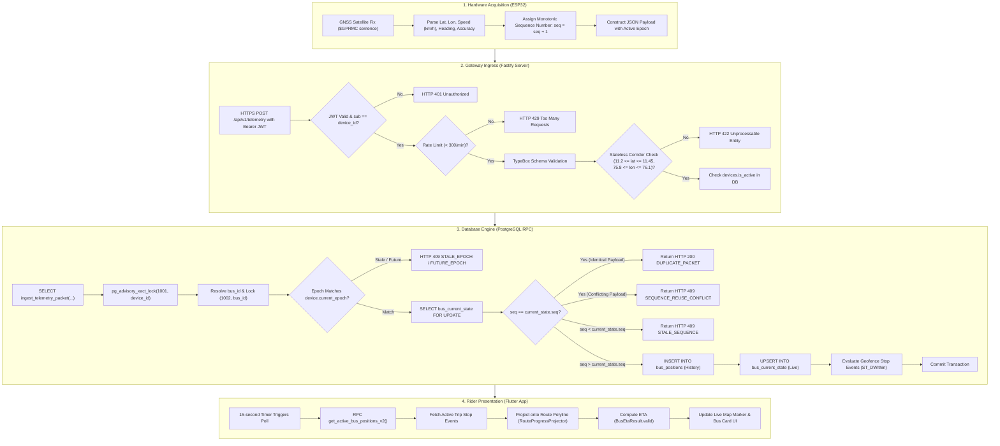

# Telemetry Lifecycle & Ingestion Engine

## 1. End-to-End Lifecycle Trace

This document details the lifecycle of a single geographic coordinate fix as it travels from physical hardware on a campus shuttle to the student's mobile screen.

---

## 2. Thresholds, Rules, and Geofencing Logic

All spatial, temporal, and kinematic thresholds are enforced with strict mathematical boundaries:

### 2.1 Spatial Boundaries (NITC Campus Corridor)
- **Bounding Box:**
  - Latitude: $[11.200000, 11.450000]\text{ N}$
  - Longitude: $[75.800000, 76.100000]\text{ E}$
- Telemetry outside this corridor is rejected immediately at the Fastify gateway before touching the database.

### 2.2 Kinematic & Velocity Thresholds
- **Speed Invariant:** $0.0 \le \text{speed} \le 120.0\text{ km/h}$.
- **Status Derivation:**
  - Speed $\le 2.0\text{ km/h} \implies \text{status} = \text{'stationary'}$.
  - Speed $> 2.0\text{ km/h} \implies \text{status} = \text{'moving'}$.
- **Accuracy Cap:** $\text{accuracy} \le 50.0\text{ meters}$.

### 2.3 Stop Geofencing & Event Generation
When a bus is assigned to an active trip, `ingest_telemetry_packet` evaluates spatial relationships against all stops on the active route:
1. **Arrival Geofence:**
   - Radius: **30 meters** (`ST_DWithin(location, stop.location, 30)`).
   - If the bus enters the 30m geofence and no recent arrival event exists for this stop on this trip:
     - Generates `bus_events` entry with `event_type = 'stop_arrival'`.
2. **Departure Hysteresis:**
   - Radius: **45 meters** (`ST_DWithin(location, stop.location, 45) = false`).
   - If the bus was previously arrived at the stop and moves beyond 45 meters:
     - Generates `bus_events` entry with `event_type = 'stop_departure'`.
   - The 15-meter buffer between arrival (30m) and departure (45m) prevents false departure triggers due to GPS jitter while the bus is dwelling.
3. **Route Corridor Deviation:**
   - Radius: **100 meters** from `routes.path`.
   - If `ST_Distance(location::geometry, routes.path) > 100`:
     - Generates `bus_events` entry with `event_type = 'route_deviation'`.

---

## 3. Timestamp Semantics & Staleness Matrix

Telemetry tracks four distinct temporal markers:

| Timestamp Attribute | Origin / Meaning | Used For |
|---|---|---|
| `recorded_at` / `timestamp` | Device GNSS clock (UTC) | Spatial sequencing, kinematic physics, historical ordering. |
| `created_at` | PostgreSQL `now()` at insert | Ingestion audit logging, pipeline latency monitoring. |
| `last_seen_at` | PostgreSQL `now()` on device record | Hardware health tracking, offline device detection. |
| `last_updated` | PostgreSQL `now()` on current state | Client-side staleness detection and polling staleness flags. |

### Client-Side Staleness Rules
In the Flutter mobile client (`Bus.fromJson` and `BusPosition.fromJson`):
- A bus position is marked **fresh** if `now() - recorded_at < 60 seconds`.
- A bus position is marked **stale (`isStale = true`)** if `now() - recorded_at >= 60 seconds`.
- Stale buses render with muted/amber badges in the UI and their arrival ETA displays as `"Unavailable"`.
- Positions older than **24 hours** are completely filtered out of `get_active_bus_positions_v2()`.
